<picture>
  <source media="(prefers-color-scheme: dark)" srcset="brand/banner-dark.svg">
  
</picture>

[](https://github.com/abiodunosagie/parley-api/actions/workflows/ci.yml)

The backend of [Parley](https://github.com/abiodunosagie/parley), the open-source Flutter app
with Claude inside, rebuilt as a NestJS service. It keeps the contract of Parley's Supabase edge
function (`POST /v1/claude`, same body, same events, same error words), so the app switches by
changing one base URL. Live at `https://parley-api.vercel.app`.

## What it does

```
Flutter app ──POST /v1/claude──▶ parley-api (NestJS on Vercel) ──▶ Anthropic API
                                   1. BodySizeGuard      declared size, before the body is read
                                   2. SupabaseAuthGuard  the Supabase access token, checked server-side
                                   3. read + validate    streamed byte limit, every block rebuilt from an allowlist
                                   4. claim a slot       one locked SQL call: per-user, per-network, project limits
                                   5. call Claude        stream SSE or return JSON, stop billing if the app leaves
                                   6. log what it spent  even on errors and disconnects
                                         │
                                         ▼
                                   Supabase Postgres (the same claude_requests table as the edge function)
```

- **Seven modes on one endpoint.** Chat, photos and PDFs with citations, rewriting stream back as
  server-sent events; job-post extraction, receipts (structured output) and the tool-using agent
  return one JSON answer.
- **The server trusts nothing.** The app is open source, so every field is untrusted: allowed models
  and block types per mode, base64 checked against the file's real signature, system prompts and
  tool definitions only on the server.
- **Limits that hold under a burst.** Every limit is checked and the request recorded inside one
  Postgres function that takes a lock, so parallel requests cannot all see the same count. Both
  backends write the same table, so switching between them does not reset anyone's budget.
- **Spend is counted honestly.** A request the app abandons mid-stream is aborted upstream and still
  logged with what streamed so far.
- **Bring your own key.** A user's own Anthropic key rides in the body for one request, is never
  stored or logged, and is blanked out of any error message before it is written to the logs.
- **No internals leak.** Every error leaves as `{ "error": "..." }` with words written for the app;
  stack traces and upstream messages stay in the server logs.

## Run it

You need Node.js 24 and the Supabase project from the [Parley repo](https://github.com/abiodunosagie/parley)
(its migrations create `claude_requests` and `claim_claude_request`).

```bash
git clone https://github.com/abiodunosagie/parley-api.git && cd parley-api
npm ci
cp .env.example .env        # fill in your Supabase URL, service role key and Anthropic key
set -a && . ./.env && set +a   # Nest does not read .env itself; this exports it to the shell
npm run start:dev           # http://localhost:3000/health
```

Then point the app at it: set `PARLEY_API_URL` in Parley's `config/parley.json`.

## Deploy (free)

It runs on Vercel's Hobby plan with no changes: `vercel.json` pins the NestJS preset, the app
becomes one function, and a stream can stay open for the function's default limit of 300 seconds
(a 95-second stream was checked live).

```bash
vercel link
vercel env add SUPABASE_URL production
vercel env add SUPABASE_SERVICE_ROLE_KEY production --sensitive
vercel env add ANTHROPIC_API_KEY production --sensitive
vercel deploy --prod
```

Vercel caps a request body at 4.5 MB, so on Vercel the API accepts up to 4.4 MB by itself (PDFs
over about 3 MB and several large photos in one message are refused). On a host without that cap
(Render, a container, a VM) the full 16 MB limit applies.

**Off Vercel, set `TRUSTED_IP_HEADER`** to a header that your host's proxy overwrites with the
caller's IP. The default, `x-vercel-forwarded-for`, is only trustworthy on Vercel; anywhere else a
caller could set it and dodge the per-network daily limit. The per-user limits apply regardless.
Every request with a token costs one Supabase auth lookup, so put the host's firewall rate
limiting in front if the API is ever flooded with bad tokens.

| Variable | Required | What it is |
| --- | --- | --- |
| `SUPABASE_URL` | yes | `https://<ref>.supabase.co` |
| `SUPABASE_SERVICE_ROLE_KEY` | yes | server-only key for auth checks and the limits table |
| `ANTHROPIC_API_KEY` | no | the project's key; without it only own-key requests are served |
| `MAX_BODY_BYTES` | no | largest body accepted: 16000000, or 4400000 on Vercel |
| `PORT` | no | port to listen on off Vercel, default 3000 |
| `TRUSTED_IP_HEADER` | no | header the host sets with the caller's IP, default `x-vercel-forwarded-for` |

## Tests

```bash
npm run lint && npx tsc --noEmit
npm test            # 35 unit tests: request, replay and own-key validation, environment
npm run test:e2e    # 17 end-to-end tests through the real Nest app: auth, size, limits, SSE, aborts
```

Against a deployed copy, `scripts/live-check.mjs` signs up a throwaway `parley-test-*` user, calls
every mode, prints what each returned and what the limits table logged, then deletes the user
(the comment at the top lists the variables it needs). It spends a few cents of Claude credit.

## Layout

```
src/
  main.ts                    boot, CORS, body parser off, shutdown hooks
  app.module.ts              wires the modules and the error filter
  config/env.ts              environment, checked once at boot (env.module.ts shares it)
  common/error.filter.ts     every error as { error }, only app-safe words
  health/                    GET /health
  claude/
    claude.module.ts         the Claude feature
    claude.controller.ts     POST /v1/claude: SSE or JSON, abort handling, 405 for other methods
    claude.service.ts        own key, validation, search budget, limits, document cap
    request-guards.ts        size and sign-in checks, before the body is read
    request-body.ts          streamed body reader with a byte limit
    supabase.service.ts      auth lookup, claim_claude_request, usage log
    ip-hash.ts               hashed network id from the host's trusted header
    token-estimate.ts        cautious token count when the API reported none
    http-error.ts            PublicError: the only errors whose words reach the app
    anthropic.ts             the only file that calls the Anthropic API
    validate*.ts             the allowlist every request passes
    config.ts                models, modes, limits
    prompts.ts, schemas.ts   system prompts, structured-output schemas, agent tools
test/claude.e2e-spec.ts      the end-to-end suite (Supabase and Anthropic faked)
scripts/live-check.mjs       every mode against a deployed copy, with a throwaway user
brand/                       banners and social preview, in Parley's brand
```

## License

MIT. Parley's brand (the mark and its colours) belongs to the Parley project; see `brand/`.
